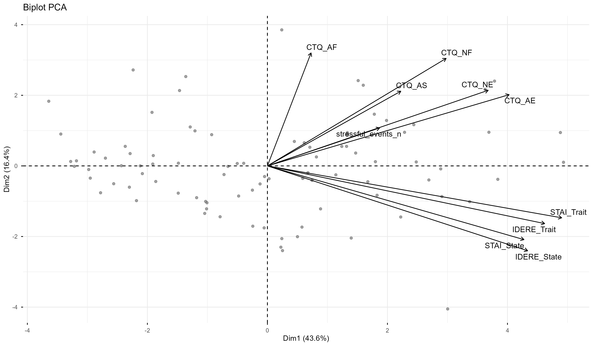
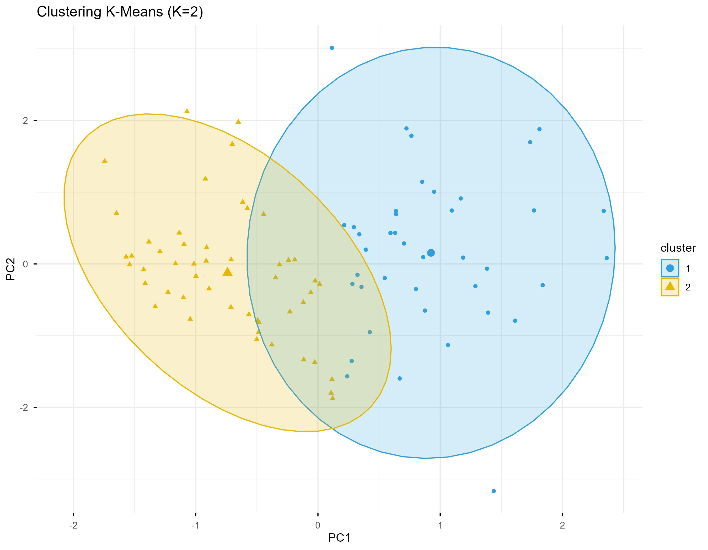

# Developmental trauma as a transdiagnostic predictor of psychopathology: a multivariate analysis

Master's Thesis in Health Psychology — Universidad Internacional de La Rioja

[](https://www.r-project.org/)

---

## Overview

This repository is a cleaned, reproducible portfolio version of a Master's thesis examining whether childhood trauma relates to psychopathology in a transdiagnostic, multivariate way — that is, across symptom domains rather than within a single diagnostic category.

The original thesis was written in Spanish; this repository presents the analytical materials in a form that can be inspected and re-run independently. The submitted thesis document remains the authoritative source for the full theoretical and methodological discussion (see [Thesis document](#11-thesis-document)).

## Research question and aim

The central question is whether childhood trauma and current psychopathology co-vary along a **shared, transdiagnostic gradient**, rather than mapping onto discrete diagnostic boundaries.

The aim was to characterise the joint structure of childhood trauma, anxiety, depression and recent stressful life events, and to identify data-driven profiles of vulnerability in this multivariate space.

Because the design is **cross-sectional and observational**, the analysis speaks to covariation and profile structure. It does not establish causal direction, temporal precedence, or any causal effect of trauma on later psychopathology.

## Sample and measures

The final analytical sample comprised **N = 90 adults** (from 92 recruited records, after applying the age criterion of 18–70 years).

| Construct | Instrument |
|---|---|
| Childhood trauma | **CTQ-SF** — five subscales: emotional abuse (`CTQ_AE`), physical abuse (`CTQ_AF`), sexual abuse (`CTQ_AS`), emotional neglect (`CTQ_NE`), physical neglect (`CTQ_NF`), plus `CTQ_TOTAL` |
| Anxiety | **STAI** — state (`STAI_State`) and trait (`STAI_Trait`) |
| Depression | **IDERE** — state (`IDERE_State`) and trait (`IDERE_Trait`) |
| Recent stressful life events | Count of recent stressful life events (`stressful_events_n`) |

The floor effect across the CTQ subscales is documented in `figures/ctq_subscale_distributions.png`.

## Analytical workflow

| Step | Method |
|---|---|
| Sample definition | Age filter (18–70); derived scale scores |
| Descriptives | n, mean, SD, min, max for all clinical variables |
| Sampling adequacy | **KMO** and **Bartlett's test of sphericity** |
| Dimensional structure | **PCA** via `prcomp(..., scale. = TRUE)`; PC1 sign oriented to maximise positive loadings |
| Interpretation | Variance explained, variable loadings, **PCA biplot** |
| Clustering tendency | **Hopkins statistic**; **silhouette** method for choosing *k* |
| Grouping | **K-means** clustering (`set.seed(123)`, `centers = 2`, `nstart = 25`) on the first three component scores |
| Cluster characterisation | Clinical profile per cluster; independent-samples *t*-tests on `CTQ_TOTAL`, `STAI_Trait`, `IDERE_Trait`, `stressful_events_n` |

## Main findings

**The data were suitable for multivariate analysis.** Sampling adequacy was good (KMO = **0.797**), and the Bartlett test was statistically significant, χ²(45) = **467.17**, *p* < .001, allowing rejection of the hypothesis that the correlation matrix is an identity matrix. The variables are therefore not independent of one another and show sufficient intercorrelation to be analysed jointly; together, both indices confirm that the data structure was suitable for PCA.

**Two latent dimensions accounted for a substantial share of variance.** PC1 explained **43.61%** and PC2 **16.36%**, for a cumulative **59.97%**.

**A general transdiagnostic severity gradient emerged.** PC1 functions as the main axis differentiating participants, and anxiety, depression and emotional trauma (both abuse and neglect) all project with long loadings in the **same** direction. Trait anxiety (loading = .430) and trait depression (.405) contribute most strongly to this axis, followed by state anxiety (.375), state depression (.380), emotional abuse (.353) and emotional neglect (.323); recent stressful events (.164) contribute more modestly. In practical terms, PC1 represents a **general factor of transdiagnostic severity**: participants positioned at one end score high across all variables simultaneously, distinguishing them from those with lower overall symptomatology.



*The biplot displays participant scores (grey) and variable loadings (arrows) on the first two components.*

**By contrast, the physical trauma dimensions contribute less to this main axis.** Physical abuse (.064) and sexual abuse (.195) have comparatively weak projections on PC1, consistent with the floor effect observed in their measurement. They are not, however, irrelevant: on **PC2**, physical abuse (.458) and physical neglect (.436) show their strongest loadings, while the anxiety–depression block takes negative values (state depression = −.344, state anxiety = −.299, trait depression = −.234, trait anxiety = −.211). The variance on this second axis is therefore attributable not to symptom severity but to the **qualitative configuration** of the maltreatment profile, with specific forms of abuse following their own trajectory.

**Participants showed a tendency toward clustering** (Hopkins = **0.668**), and the silhouette analysis supported a **two-cluster solution**:

- **Cluster 1 — n = 40**
- **Cluster 2 — n = 50**



*Projection of participants on PC1 and PC2, coloured by k-means cluster assignment.*

**Cluster 1 showed higher childhood trauma, trait anxiety, trait depression, and a greater number of recent stressful events** than Cluster 2. All four between-cluster comparisons reached statistical significance (*t* = 9.24, *t* = 9.55, *t* = 9.54, *p* < .001; and *t* = 2.10, *p* = .039 respectively).

### Interpretation and scope

These clusters should be read as **data-driven profiles positioned along a vulnerability continuum** — descriptive groupings derived from statistical structure in this sample. They are **not diagnostic categories**, they do not correspond to any validated nosological system, and they carry no clinical or diagnostic implication. The labels are used solely to refer to relative position within the observed distribution.

No causal claim is made or implied: the cross-sectional design cannot establish that trauma produced the observed symptom profiles, only that these variables covary in this sample.

## Repository structure

```
.
├── README.md                              # This file
├── data/
│   └── analysis_data.csv                  # Derived analysis dataset (N = 90)
├── R/
│   ├── analysis.R                         # Primary reproducible analysis
│   └── create_analysis_dataset.R          # Documents dataset construction
├── figures/
│   ├── ctq_subscale_distributions.png     # CTQ subscale distributions
│   ├── pca_contrib_pc1.png                # Variable contributions to PC1
│   ├── pca_contrib_pc2.png                # Variable contributions to PC2
│   ├── pca_biplot.png                     # PCA biplot
│   ├── silhouette.png                     # Silhouette analysis
│   └── cluster_kmeans.png                 # K-means cluster projection
├── tables/
│   ├── README.md                          # Provenance of each table
│   ├── clinical_descriptives.csv          # Reproducible
│   ├── pca_loadings.csv                   # Reproducible
│   ├── cluster_clinical_comparison.csv    # Reproducible
│   ├── sample_characteristics.csv         # Static aggregate (thesis Table 1)
│   └── cluster_sociodemographic_comparison.csv  # Static aggregate (thesis Table 4)
├── thesis/
│   └── thesis.pdf                         # Submitted thesis
└── ethics/
    └── committee_evaluation.pdf           # Ethics committee evaluation
```

## Reproducibility

The primary analysis is fully reproducible from the released data:

```bash
Rscript R/analysis.R
```

All paths are resolved relative to the repository root, so the script runs from any working directory. Figures and CSV tables are regenerated on each run, and results are deterministic: the clustering seed is fixed (`set.seed(123)`) and K-means uses `nstart = 25`.

**Required R packages:** `psych`, `cluster`, `factoextra`, `ggplot2`, `dplyr`, `tidyr`.

Verified results from the released dataset: KMO = 0.797; Bartlett χ²(45) = 467.17; PC1 = 43.61%; PC2 = 16.36%; clusters of n = 40 and n = 50.

`R/create_analysis_dataset.R` documents, in full, how the derived dataset was produced from the restricted raw source data — including the item-inversion and scoring rules for each instrument. **The raw source data are not included in this repository**, so this script documents provenance rather than providing an end-to-end rebuild from source.

## Data availability and privacy

**`data/analysis_data.csv` is the only participant-level data released.** It contains just an anonymous sequential identifier, the count of recent stressful events, and the ten derived scale and subscale scores required to reproduce the primary multivariate analyses.

To protect participant privacy, the following are **deliberately withheld**:

- **Raw item-level questionnaire responses** (all CTQ-SF, STAI and IDERE items)
- **Participant-level sociodemographic data** (exact age, gender, education, employment, company size, work schedule, economic situation, place of residence, household composition, caregiving hours, perceived social support)
- **Free-text responses** describing stressful events
- **Timestamps**

Consequently, two families of analysis **cannot be independently reproduced** from the public dataset, by design rather than by omission:

- **Item-level reliability analyses** (e.g. Cronbach's alpha) — these require the individual questionnaire items, which are not released.
- **Participant-level sociodemographic analyses** — these require the sociodemographic variables, which are not released.

Aggregated sociodemographic results **as reported in the submitted thesis** are preserved in `tables/sample_characteristics.csv` (thesis Table 1) and `tables/cluster_sociodemographic_comparison.csv` (thesis Table 4). These are static aggregate transcriptions of the thesis, **not** recomputed from participant-level records, and are retained so the submitted results remain verifiable against the source document.

Direct identifiers (names, contact details, timestamps) and participant-level sociodemographic quasi-identifiers have been removed from the released dataset in order to reduce re-identification risk. The identifier provided is a sequential index with no linkage to any source record.

## Ethics

The study was evaluated by the TFM Research Committee (*Comisión de Investigación de TFM*) of the Universidad Internacional de La Rioja, which issued a **favourable** evaluation on 21 October 2025, confirming that the project met the institution's essential ethical requirements and deontological criteria.

The official evaluation report is included at [`ethics/committee_evaluation.pdf`](ethics/committee_evaluation.pdf).

Participation was voluntary and informed; all participants provided informed consent prior to data collection, as recorded in the source dataset.

## Thesis document

The complete submitted thesis is available at [`thesis/thesis.pdf`](thesis/thesis.pdf).

It is written in Spanish and contains the full theoretical framework, methodology, complete results, APA-style tables, and discussion that are not reproduced here. In the event of any discrepancy, the thesis document is authoritative.

## Citation

If you use this work, please cite the thesis itself. The evaluation report referenced above documents the institutional assessment of the research.
